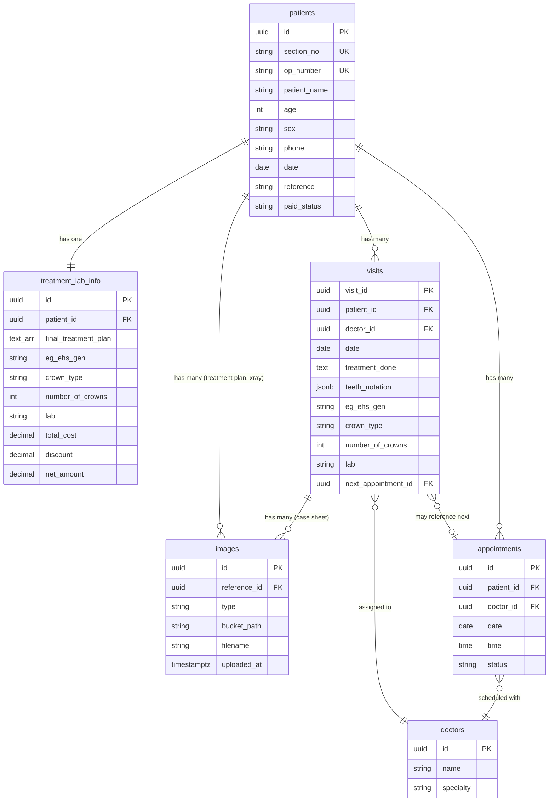

# V Dental Care — FRONTEND AUDIT

**Date:** 2026-09-13  
**Scope:** Front Office, Client Head, Working Doctor  
**Auditor:** Automated cross-dashboard deep audit  
**Build status:** `npm run lint` ✅ | `npx tsc --noEmit` ✅ | `npm run build` ✅

---

## 1. Architecture Status

| Layer | Implementation | Verdict |
|---|---|---|
| **UI Components** | React/Next.js, role-parameterised, no direct data access | ✅ Clean |
| **Service Layer** | `opService.ts`, `doctorService.ts` — async methods returning Promises | ✅ Replaceable |
| **Repository Layer** | `mockOPRepository.ts`, `mockDoctorRepository.ts` — in-memory arrays | ✅ Isolated |
| **Type Definitions** | `op.ts`, `doctor.ts` | ✅ Single source of truth |

**No UI component imports a mock repository directly.** Every component goes through the service layer.

---

## 2. Cross-Dashboard Consistency

### 2.1 Foundational OP Identity

All three dashboards render the **same `PatientOP` interface** via the shared `PatientInfoTable` component inside `OPDetails`.

| Field | In `PatientOP` | In `PatientInfoTable` UI | In `NewOPForm` | Consistent? |
|---|---|---|---|---|
| Section Number | `sectionNo: string` | ✅ | Auto-generated | ✅ |
| OP Number | `opNumber: string` | ✅ | ✅ | ✅ |
| Patient Name | `patientName: string` | ✅ | ✅ | ✅ |
| Age | `age: number` | ✅ | ✅ | ✅ |
| Sex | `sex: "Male" \| "Female" \| "Others"` | ✅ | ✅ | ✅ |
| Phone / WhatsApp | `phone: string` | ✅ | ✅ | ✅ |
| Date | `date: string` | ✅ | ✅ | ✅ |
| Reference | `reference: string` | ✅ | ✅ | ✅ |
| Paid / Free | `paidStatus: "Paid" \| "Free"` | ✅ | ✅ | ✅ |

Every shared field has **exactly one authoritative type definition** in `PatientOP`.

### 2.2 Image Collections

| Collection | Type | Stored In | Consistent? |
|---|---|---|---|
| Treatment Plan | `OPImage[]` | `CompleteOPRecord.treatmentPlanImages` | ✅ |
| X-Ray | `OPImage[]` | `CompleteOPRecord.xrayImages` | ✅ |
| Case Sheet (per visit) | `OPImage[]` | `VisitCaseSheet.images` | ✅ |

### 2.3 Doctor Case Sheets — Visit Independence

| Check | Result |
|---|---|
| Model is `VisitCaseSheet[]` (array of independent visits) | ✅ |
| Each visit has its own `visitId`, `date`, `doctorId`, `treatmentDone`, `teethNotation`, `images` | ✅ |
| `DoctorCaseSheet.tsx` saves via `doctorService.saveVisitToOP()`, which finds or pushes — never overwrites | ✅ |
| `VisitHistory.tsx` lets user switch between existing visits and create new ones | ✅ |
| Previous visits are preserved on save | ✅ |

### 2.4 Appointments — Independence from OP

| Check | Result |
|---|---|
| `Appointment` type is defined independently in `doctor.ts` | ✅ |
| `Appointment` references `opNumber` and `doctorId` but is **not nested** inside `CompleteOPRecord` | ✅ |
| Stored in a separate array in `mockDoctorRepository` | ✅ |
| Visit merely stores `nextAppointmentId?: string` as a foreign key reference, not the appointment object | ✅ |

### 2.5 Teeth Notation

| Check | Result |
|---|---|
| Model: `TeethNotation = { q1, q2, q3, q4 }` — four explicitly named quadrant fields | ✅ |
| UI: CSS `grid grid-cols-2 grid-rows-2` inside a single outer bordered box | ✅ |
| Quadrants visually separated by `border-r-2` and `border-b-2` | ✅ |
| Each quadrant has its own label (Q1–Q4) and its own `<input>` | ✅ |

### 2.6 Crown Type / Number of Crowns / Lab — Cross-Role Consistency

| Field | Working Doctor (Visit) | Client Head (`TreatmentLabInfoTable`) | Data sync |
|---|---|---|---|
| Crown Type | `<select>` from `doctorService.getCrownTypes()` | `<select>` hardcoded options | ⚠️ See issue C-1 |
| Number of Crowns | `<input type="number" min=0 step=1>` | `<input type="number" min=0 step=1>` | ✅ |
| Lab | `<select>` from `doctorService.getLabs()` | `<select>` hardcoded options | ⚠️ See issue C-1 |
| E+G / EHS / GEN | `<select>` with 3 options | `<select>` with 3 options | ✅ |

---

## 3. Data-Model Inconsistencies

### C-1: CRITICAL — Crown Type and Lab Dropdown Sources Are Divergent

`TreatmentLabInfoTable.tsx` (used by Client Head) **hardcodes** its Crown Type and Lab options:

```tsx
// TreatmentLabInfoTable.tsx lines 60-65
<option value="PFM">PFM</option>
<option value="Zirconia">Zirconia</option>
<option value="E-Max">E-Max</option>
<option value="Metal">Metal</option>
```

`DoctorCaseSheet.tsx` (used by Working Doctor) dynamically loads them from `doctorService`:

```tsx
doctorService.getCrownTypes().then(setCrownTypes);
doctorService.getLabs().then(setLabs);
```

**Impact:** If a crown type or lab is added to the mock catalogue, the Working Doctor will see it but the Client Head will not. When the backend provides these, Client Head's `TreatmentLabInfoTable` would still show stale hardcoded values.

**Fix:** `TreatmentLabInfoTable` must also consume crown types and labs from the service, not hardcode them.

### C-2: NON-CRITICAL — `TreatmentLabInfo` Stores Cost/Discount as Strings

`TreatmentLabInfo` uses `string` for `totalTreatmentCost`, `finalDiscount`, and `netAmount` (e.g., `"5,000"`). This forces the UI to parse formatted strings with `Number(val.replace(/,/g, ""))` in `CostDiscount.tsx`.

**Impact:** When mapped to PostgreSQL, these must be `NUMERIC` / `DECIMAL` columns. The current string representation will require a parsing layer or a type migration.

**Fix (recommended for backend phase):** Change to `number` in the type, format for display only in the UI.

### C-3: NON-CRITICAL — `VisitCaseSheet` Clinical Fields Are All Optional

In `op.ts`, `doctorId`, `treatmentDone`, `teethNotation`, etc. are all optional (`?`). This was done to keep backward compatibility with older mock data that only had `visitId`, `date`, and `images`.

**Impact:** Acceptable for the frontend mock phase, but the backend schema should enforce `doctor_id NOT NULL` and `date NOT NULL` at the database level.

### C-4: NON-CRITICAL — Date Format Inconsistency

- `PatientOP.date` and mock data use `DD/MM/YYYY` format (e.g., `"06/09/2026"`)
- `DoctorCaseSheet` uses `YYYY-MM-DD` from `<input type="date">` (ISO format)
- `Appointment.date` uses `DD/MM/YYYY` in mock data

**Impact:** When persisting to PostgreSQL (`DATE` column), a consistent ISO format (`YYYY-MM-DD`) should be standardised. This is a backend-phase concern.

### C-5: NON-CRITICAL — `mockOPRepository.findAll()` Returns Shallow Copy

`mockOPRepository.ts` line 9: `return [...this.data]` creates a shallow copy. Nested objects (like `treatmentLab`, `caseSheets`) are still shared references. This means mutations in `doctorService.saveVisitToOP` (which directly mutates `op.caseSheets` and `op.treatmentLab`) work accidentally.

**Impact:** Not a bug in mock mode, but the mutation pattern will not work with a real API. The backend phase will naturally fix this since saves become HTTP requests.

---

## 4. API-Readiness Issues

### A-1: Homepage Redirect Points to Dead Route

`src/app/page.tsx` redirects to `/front-office/op-details`, which **does not exist** as a route. The correct route is `/front-office/op-list`.

### A-2: Working Doctor OPList Has No Doctor Name Filter

The specification requires: *"Doctor Name filter works."* The shared `OPList` and `OPFilters` components only support a single search field. There is **no doctor name filter dropdown** in the Working Doctor's OP list.

**Impact:** The Working Doctor cannot filter patients by assigned doctor. This requires extending `OPFilters` or creating a doctor-specific filter for the Working Doctor route.

### A-3: `opService.searchOP` Does Not Search by Doctor Name

`opService.ts` only searches by `opNumber`, `patientName`, and `phone`. Since doctor assignment is at the visit level (inside `caseSheets[].doctorId`), filtering by doctor would require traversing the visits array.

### A-4: Appointment Time Slots Are Hardcoded

`AppointmentSection.tsx` hardcodes 12 time slots. The backend will likely need to provide available slots dynamically based on the doctor's schedule.

**Impact:** Acceptable for mock phase; the `<select>` can later be populated from `doctorService.getAvailableSlots()`.

### A-5: `FinalTreatmentPlan` Options Are Hardcoded

`FinalTreatmentPlan.tsx` hardcodes 6 treatment options. Like Crown Type and Lab, these should eventually come from the backend catalogue.

### A-6: `PatientLedger` Is a Placeholder

`PatientLedger.tsx` renders a static `<select>` with hardcoded payment methods. It has no data binding, no `onChange`, and no connection to the data model.

---

## 5. Database Relationships Required



### Fields Requiring Database IDs / Foreign Keys

| Current Field | Current Type | Required DB Column |
|---|---|---|
| `PatientOP.opNumber` | `string` | `patients.op_number` (unique, not PK — add UUID PK) |
| `PatientOP.sectionNo` | `string` | `patients.section_no` (auto-increment or sequence) |
| `VisitCaseSheet.visitId` | `string` | `visits.visit_id` (UUID PK) |
| `VisitCaseSheet.doctorId` | `string` | `visits.doctor_id` (FK to `doctors.id`) |
| `VisitCaseSheet.nextAppointmentId` | `string` | `visits.next_appointment_id` (FK to `appointments.id`) |
| `Appointment.id` | `string` | `appointments.id` (UUID PK) |
| `Appointment.opNumber` | `string` | `appointments.patient_id` (FK to `patients.id`) |
| `Appointment.doctorId` | `string` | `appointments.doctor_id` (FK to `doctors.id`) |
| `Doctor.id` | `string` | `doctors.id` (UUID PK) |
| `OPImage.id` | `string` | `images.id` (UUID PK) |
| `TreatmentLabInfo` (no explicit ID) | embedded | `treatment_lab_info.id` (UUID PK, FK to `patients.id`) |

---

## 6. Image-Storage Requirements

| Current | Supabase Storage Equivalent |
|---|---|
| `OPImage.url: string` | Supabase signed URL or public URL |
| `OPImage.filename: string` | Bucket object key / path |
| `OPImage.uploadedAt: string` | `created_at` timestamp from Supabase |
| Upload button in `ImageGallerySection` | Wire to `supabase.storage.from('bucket').upload()` |

The `ImageGallerySection` component already accepts an `isEditable` prop and renders an upload button when true. The component is fully abstracted — it takes `{ name, date, thumbnailUrl? }` display objects and doesn't know about storage implementation.

**Verdict:** ✅ Ready for Supabase Storage integration.

---

## 7. Permission Issues

| Permission | Front Office | Client Head | Working Doctor | Correct? |
|---|---|---|---|---|
| Edit Treatment Lab Info | ❌ | ✅ | ❌ | ✅ |
| Edit Final Treatment Plan | ❌ | ✅ | ❌ | ✅ |
| Edit Cost and Discount | ❌ | ✅ | ❌ | ✅ |
| Upload Treatment Plan Images | ❌ | ✅ | ❌ | ✅ |
| Upload X-Ray Images | ❌ | ✅ | ❌ | ✅ |
| Edit Doctor Case Sheet | ❌ | ❌ | ✅ | ✅ |
| Save OP Details (top-level) | ❌ | ✅ | ✅ | ✅ |
| Create New OP | ✅ (NewOPForm) | ❌ | ❌ | ✅ |

**No dashboard contains navigation links to another role.** Each `layout.tsx` defines its own isolated `navItems` with hrefs scoped to its own route prefix.

---

## 8. UI Issues

### U-1: Homepage Redirect Broken

`src/app/page.tsx` redirects to `/front-office/op-details` — this route doesn't exist. Should be `/front-office/op-list` or a role-selection page.

### U-2: OPList Sorting Not Explicitly "Newest First"

The specification requires *"Newest OP appears first."* `OPList.tsx` renders records in the order returned by `opService.searchOP()`, which returns them in array insertion order. There is no explicit sort by date or section number.

### U-3: Missing Doctor Name Filter for Working Doctor

As noted in A-2, the Working Doctor's OP list uses the exact same `OPList` component as Front Office and Client Head with no additional doctor-specific filter.

---

## 9. Hardcoded Values and Hidden Coupling

| Location | Hardcoded Value | Risk |
|---|---|---|
| `TreatmentLabInfoTable.tsx:60-65` | Crown Type options | Will diverge from catalogue |
| `TreatmentLabInfoTable.tsx:91-95` | Lab options | Will diverge from catalogue |
| `FinalTreatmentPlan.tsx:12-19` | Treatment plan checkboxes | Should come from catalogue |
| `AppointmentSection.tsx:49-62` | Appointment time slots | Should come from backend |
| `NewOPForm.tsx:7` | Reference options | Should come from catalogue |
| `PatientLedger.tsx:13-17` | Payment method options | Placeholder — no data binding |
| `mockOPRepository.ts:6` | `nextSectionNo = 1028` | Will be replaced by DB sequence |

---

## 10. Mock Data Adequacy

| Requirement | Demonstrated? | Notes |
|---|---|---|
| Multiple OPs | ✅ | 3 patients (OP1024, OP1025, OP1026) |
| Multiple visits for one OP | ⚠️ | OP1025 has 1 visit; **no OP has 2+ visits** in seed data |
| Multiple appointments | ✅ | 2 appointments (app-1, app-2) |
| Different doctors | ✅ | 3 doctors |
| Different crown types | ✅ | 4 crown types in catalogue |
| Different labs | ✅ | 3 labs in catalogue |
| Multiple images | ✅ | OP1025 has 3 treatment plan, 2 xray, 2 case sheet images |

**No OP in the seed data has multiple visits.** OP1025 has exactly one visit with two images. The specification requires demonstrating that "previous visits are not overwritten," which cannot be visually verified from seed data alone — it can only be verified by manually creating a second visit at runtime.

---

## 11. Summary of Issues

### Critical Issues

| ID | Issue | Impact |
|---|---|---|
| **C-1** | Crown Type and Lab dropdowns in `TreatmentLabInfoTable` are hardcoded; Working Doctor uses service-backed catalogue | **Data inconsistency between roles** — will break when backend provides dynamic catalogues |

### Non-Critical Issues

| ID | Issue | Impact |
|---|---|---|
| U-1 | Homepage redirects to dead route `/front-office/op-details` | User sees 404 on first visit |
| U-2 | No "newest first" sorting in OPList | UX deviation from spec |
| U-3 | No doctor name filter for Working Doctor | Missing specified feature |
| C-2 | Cost/discount stored as formatted strings | Backend migration needed |
| C-3 | Visit clinical fields all optional in TypeScript | DB should enforce NOT NULL |
| C-4 | Date format inconsistency (DD/MM/YYYY vs YYYY-MM-DD) | Backend normalization needed |
| C-5 | Shallow copy in `findAll()` allows accidental mutation | Works in mock, not real API |
| A-4 | Appointment time slots hardcoded | Backend should provide dynamically |
| A-5 | Treatment plan options hardcoded | Should come from catalogue |
| A-6 | PatientLedger is unconnected placeholder | No data model backing |

---

## 12. Recommended Fixes (Before Backend)

| Priority | Fix | Effort |
|---|---|---|
| MUST FIX | **C-1**: Make `TreatmentLabInfoTable` consume crown types and labs from `doctorService` instead of hardcoding | Small |
| MUST FIX | **U-1**: Fix homepage redirect to `/front-office/op-list` | Trivial |
| SHOULD FIX | **U-2**: Sort OPList by date descending (newest first) | Small |
| SHOULD FIX | **U-3**: Add doctor name filter to Working Doctor OPList | Medium |
| SHOULD FIX | Mock data: Add a second visit to OP1025 to demonstrate multi-visit | Trivial |
| NICE TO HAVE | Standardise date format to ISO `YYYY-MM-DD` across all mock data | Small |

---

## 13. GO / NO-GO Decision

### Structural Checks (the three things you said you'd check hardest)

| Check | Verdict | Evidence |
|---|---|---|
| **Case sheets are genuinely visit-based** | ✅ **PASS** | `VisitCaseSheet[]` array, each with own `visitId`, `doctorId`, `images`. `saveVisitToOP` finds-or-pushes, never overwrites. |
| **Appointments are genuinely independent** | ✅ **PASS** | `Appointment` type in `doctor.ts`, stored in separate `mockDoctorRepository.appointments[]`, not embedded in `CompleteOPRecord`. Visit only holds optional `nextAppointmentId` FK reference. |
| **Teeth notation is genuinely structured as 2x2 quadrants** | ✅ **PASS** | `TeethNotation = { q1, q2, q3, q4 }`. UI is a single outer bordered `<div>` with `grid-cols-2 grid-rows-2`, quadrants separated by `border-r-2` and `border-b-2`. |

### Final Decision

## CONDITIONAL GO

The architecture is structurally sound and maps cleanly to PostgreSQL/Supabase. The three core structural requirements pass. However, **issue C-1 (hardcoded Crown Type/Lab in Client Head)** is a real data-consistency risk that must be fixed before backend work begins.

**Fix C-1 and U-1 → then full GO.**
